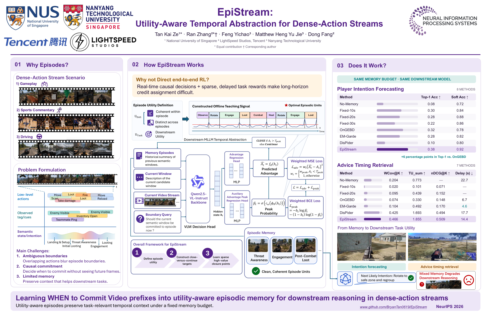

# EpiStream: Utility-Aware Temporal Abstraction for Dense-Action Streams

**Kaize Tan, Ran Zhang, Feng Yichao, Matthew H Jie, and Dong Fang** · NeurIPS 2026

[Paper](https://openreview.net/forum?id=OZd2dd0dZ6) · [NeurIPS](https://neurips.cc/virtual/2026/poster/153023) · [Poster PDF](assets/epistream-poster.pdf) · [Reproduce](REPRODUCE.md) · [Checkpoint](models/epistream-qwen25vl-3b-lora-0428/)

EpiStream learns when to commit an evolving episode in a dense-action stream. The policy predicts the advantage of committing at the current time and uses an auxiliary head to identify high-advantage decision points.

[](assets/epistream-poster.pdf)

## What this release contains

| Component | Entry point |
| --- | --- |
| Telemetry parsing and offline episode construction | [src/map.py](src/map.py), [src/segment_gt.py](src/segment_gt.py) |
| Decision-point sampling and input prompts | [dataset/dataset_construction.py](dataset/dataset_construction.py) |
| Utility targets and dual-head training | [src/compute_utility_forward_looking.py](src/compute_utility_forward_looking.py), [src/sft_train.py](src/sft_train.py), [scripts/sft_train.sh](scripts/sft_train.sh) |
| Scoring saved segmentations against telemetry | [src/evaluate.py](src/evaluate.py), [src/metrics.py](src/metrics.py) |
| 0428 model artifacts | [Checkpoint manifest](models/epistream-qwen25vl-3b-lora-0428/MANIFEST.md) |

The checkpoint includes a LoRA adapter for `Qwen/Qwen2.5-VL-3B-Instruct`, a commit-advantage regression head, an auxiliary peak classification head, and tokenizer files. See [Model Release](MODEL_RELEASE.md) for artifact details.

## Getting started

From the repository root, install the dependencies and inspect the available entry points.

```bash
python3 -m pip install -r requirements.txt
python3 src/evaluate.py --help
python3 dataset/dataset_construction.py --help
```

To score an existing segmentation, supply the matching telemetry log and a prediction JSON using the schema in the [reproduction guide](REPRODUCE.md).

```bash
python3 src/evaluate.py \
  --input /path/to/match.txt \
  --llm_result /path/to/predicted_segments.json \
  --output_dir output/evaluation
```

## Data and reproducibility

Training takes sampled frames, a current-window description built from telemetry and the reference window label, and summaries of earlier windows. The training launcher requires separately supplied benchmark inputs. See the [reproduction guide](REPRODUCE.md) for the cache and held-out split inputs and the scope of the public evaluator.

The release provides offline training and scoring code. The benchmark logs, screenshots, per-match training samples, memory-card cache, held-out split, streaming inference runner, and downstream evaluation pipeline are outside this release. The paper describes the study configuration. The shell launcher exposes its own defaults for training runs.

## Citation

```bibtex
@inproceedings{tan2026epistream,
  title     = {EpiStream: Utility-Aware Temporal Abstraction for Dense-Action Streams},
  author    = {Tan, Kaize and Zhang, Ran and {Feng Yichao} and {Matthew H Jie} and Fang, Dong},
  booktitle = {Advances in Neural Information Processing Systems},
  year      = {2026},
  url       = {https://openreview.net/forum?id=OZd2dd0dZ6}
}
```

## License

The repository code is released under the [MIT License](LICENSE). See the [upstream model card](https://huggingface.co/Qwen/Qwen2.5-VL-3B-Instruct) for the base model terms.
